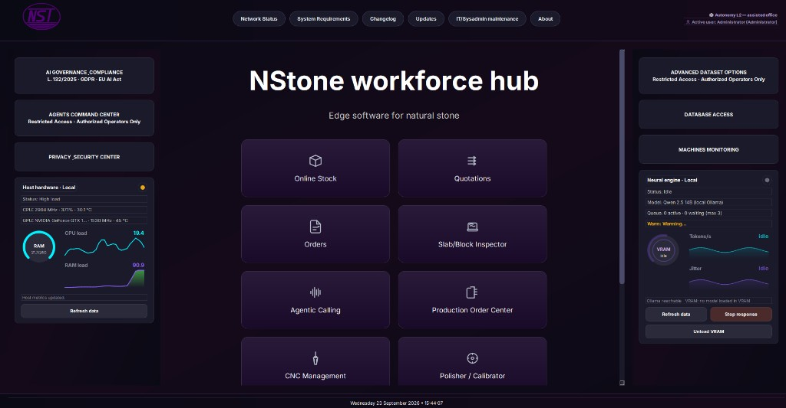
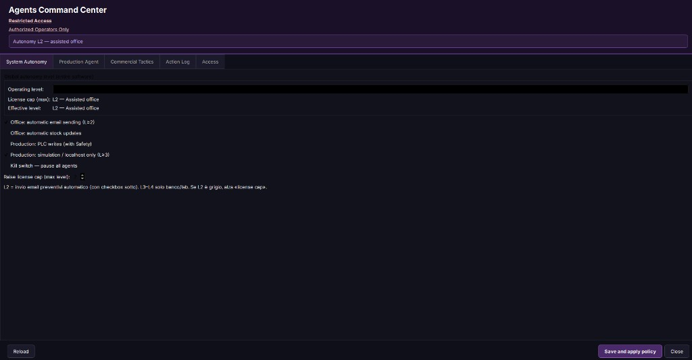
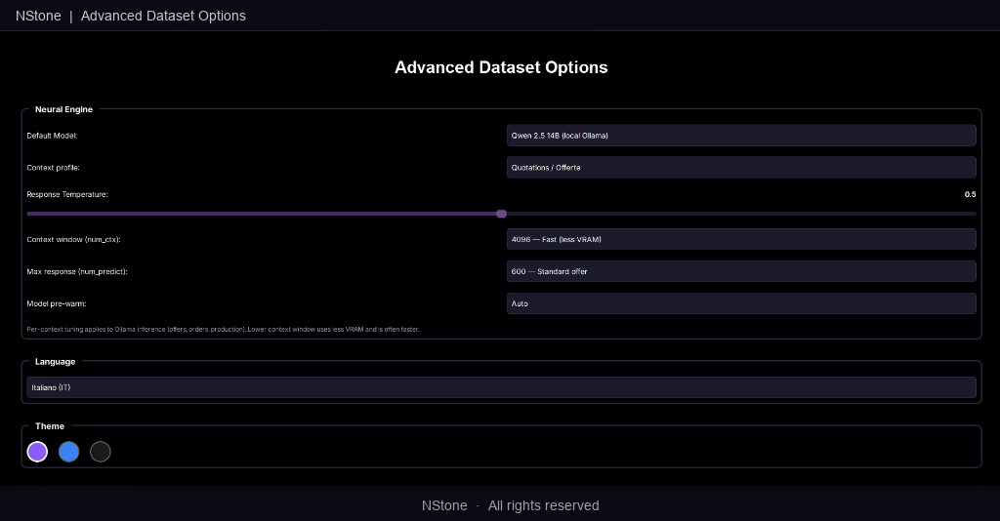
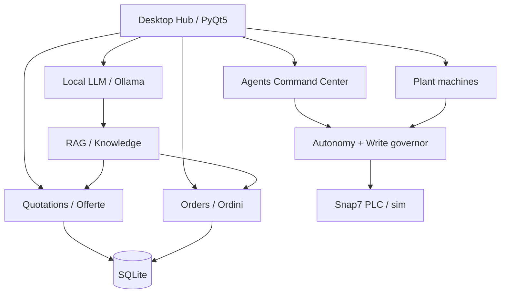

# NStone LLM

[](https://github.com/marconi845-svg/NStone/actions/workflows/ci.yml)

**Status: public demo / private-beta product** — source is viewable; reuse requires a written license (see [`LICENSE`](LICENSE)).

Agentic OS for natural stone companies: office (requests, **quotations**, **orders**),
plant (multifilo, polisher, CNC via Snap7 **simulator** or live), **RAG / knowledge**,
and governance (autonomy levels, fail-closed PLC writes, audit) in one local-first
desktop app with optional Ollama LLM.

## Screenshots

### Workforce hub



### Agents Command Center



### Advanced Dataset Options (Neural Engine)



## Architecture




**Office:** quotations (offerte), orders (ordini), email/IMAP pipelines, pricing.  
**RAG:** knowledge ingest + retrieval fabric grounding LLM replies.  
**Plant:** multifilo, polisher/calibrator, CNC — writes gated by governor.  
**LLM:** local Ollama (e.g. Qwen 2.5 14B); Gemini optional via `config.json`.

## Quick start

```bash
git clone https://github.com/marconi845-svg/NStone.git
cd NStone
python -m venv .venv
# Windows: .venv\Scripts\activate
pip install -r requirements.txt
copy config.json.example config.json
python run.py
```

On Windows you can also use `00_AVVIA_NSTONELLM.bat`.

Initialize the local demo database (SQL only):

```bash
python database/init_db.py
```

### Config (do not commit secrets)

1. Copy `config.json.example` → `config.json`
2. Fill only what you need (Gmail app password, Gemini key, machine IPs)
3. **Never commit** `config.json`, `*.db`, `ngrok.exe`, or `bin/*.dll` — they are gitignored

Optional local LLM:

```bash
ollama pull qwen2.5:14b-instruct-q4_0
```

## Layout

| Path | Role |
|------|------|
| `app/` | Main window |
| `ui/` | PyQt windows (hub, quotations, orders, agents, …) |
| `modules/` | Orders, quotations, knowledge/RAG, pricing |
| `agents/` | Office/plant agent runtime |
| `core/` | Autonomy, config, governance |
| `plc/` | Snap7 helpers, write governor |
| `machines/` | Machine adapters |
| `llm/` | Ollama / Gemini services |
| `plc_maps/` | **Synthetic** demo DB maps only |
| `database/` | SQLite schema + seed (SQL only) |
| `data/` | Runtime DB (gitignored) + knowledge samples |
| `tests/` | Pytest suite |

## Tests / CI

```bash
python -m pytest tests/ -q
```

## Security

- Rotate any credentials that ever appeared outside a private machine
- PLC maps in this tree are **NStone-authored demos**, not OEM manuals
- FreeSWITCH lab password must be changed (`CHANGE_ME_SIP_PASSWORD`)

## License

**Proprietary — all rights reserved / view-only.** [`LICENSE`](LICENSE)  
Third-party (incl. **PyQt5 GPL** warning): [`THIRD_PARTY.md`](THIRD_PARTY.md)
